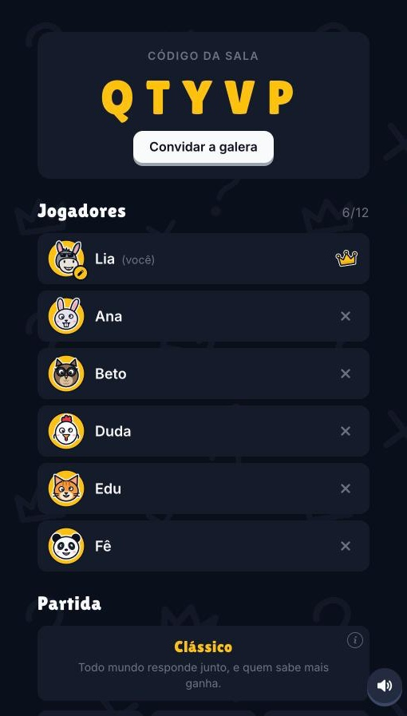
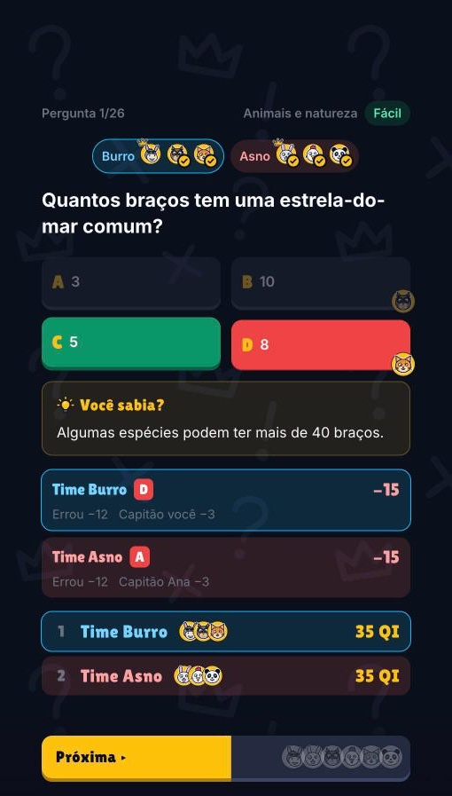
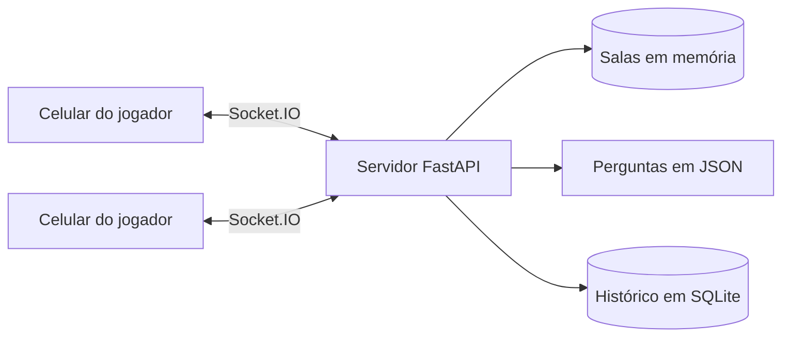

<div align="center">


**O party game de quiz para descobrir quem é o menos burro da galera.**

Crie uma sala, mande o código e joguem juntos, cada um no próprio celular.

[](https://github.com/Kalilnobrega/QuemSabeMenos/actions/workflows/ci.yml)


### [▶ Jogar agora](https://quem-sabe-menos.vercel.app)

</div>

## Telas

| | | | |
|:---:|:---:|:---:|:---:|
|  |  |  |  |
| **Início** | **Lobby** | **Pergunta** | **Revelação** |
|  |  |  |  |
| **Chutômetro** | **Batata quente** | **Times** | **Pódio** |

## Como jogar

1. **Crie uma sala** e escolha um apelido e um bicho.
2. **Chame a galera** com o código de 5 letras ou o link. A sala aceita de 2 a 12 jogadores.
3. **Responda rápido.** Cada um joga no próprio aparelho, sem instalar nada.
4. **Veja quem sabe menos.** No fim, o pódio coroa o melhor e entrega o pior.

## Modos de jogo

| Modo | Como funciona |
|---|---|
| **Clássico** | Todo mundo responde junto, e quem sabe mais ganha. |
| **Especialista** | Alguém escolhe o tema e ganha +25% nos acertos. |
| **Times** | O time vota junto e tem um QI só. |
| **Último de pé** | Errou, perde vida. Sobraram dois, é X1. |
| **Batata quente** | Acertou, passa. Explodiu na mão, está fora. |
| **Chutômetro** | Quem chutar mais perto do número ganha QI. |

## Destaques

- **18 mil perguntas em 14 temas:** 10.850 de alternativas, 5.810 de chute e 1.340 frases de verdadeiro ou falso.
- **Mais de 50 poderes** opcionais, entre ajudas e sabotagens, com raridades lendária e mítica.
- **Prêmios no fim da partida**, com até 3 destaques em cada jogo.
- **16 bichos** para escolher, e bicho repetido ganha outra cor de fundo.
- **Controle do anfitrião** sobre modo, temas, tempo, poderes e quem fica na sala.
- **Reconexão automática:** quem cai tem 30 segundos para voltar sem perder o lugar.
- **Feito para o celular**, com sons próprios e suporte a movimento reduzido.

> As perguntas foram escritas sem conferência em fontes externas. Achou uma resposta errada? [Abra uma issue](https://github.com/Kalilnobrega/QuemSabeMenos/issues).

## Tecnologias

| Camada | Tecnologias |
|---|---|
| **Frontend** | React 19, TypeScript, Vite, Tailwind CSS 4, Socket.IO Client |
| **Backend** | Python 3.12, FastAPI, python-socketio, Pydantic, Uvicorn |
| **Dados** | Perguntas em JSON, salas em memória e histórico de partidas em SQLite |
| **Qualidade** | pytest, Ruff, oxlint, Prettier e GitHub Actions |
| **Hospedagem** | Vercel no frontend e Railway no backend |

## Arquitetura

O servidor é a fonte da verdade. Ele guarda as salas, controla o tempo das fases e calcula os pontos. Cada jogador recebe só o estado que pode ver, porque os poderes de cada um são secretos.



Os eventos são definidos como modelos Pydantic e viram tipos TypeScript, para o servidor e o frontend falarem a mesma língua.

### Estrutura do projeto

```text
backend/
├── app/
│   ├── main.py         # API, eventos do Socket.IO e condução das partidas
│   ├── rooms.py        # Salas, jogadores e configurações
│   ├── events.py       # Contrato dos eventos (modelos Pydantic)
│   ├── game.py         # Clássico e Especialista
│   ├── teams.py        # Times
│   ├── survival.py     # Último de pé
│   ├── hot_potato.py   # Batata quente
│   ├── estimate.py     # Chutômetro
│   ├── duel.py         # X1
│   ├── powerups.py     # Poderes
│   ├── awards.py       # Prêmios do fim da partida
│   ├── history.py      # Histórico das partidas
│   ├── questions/      # Perguntas de alternativas
│   ├── estimates/      # Perguntas de chute
│   └── true_false/     # Frases de verdadeiro ou falso
└── tests/

frontend/src/
├── components/         # Telas e modos de jogo
├── lib/                # Conexão, sons, animações e armazenamento
├── types/              # Tipos gerados a partir do backend
└── assets/             # Marca, bichos e sons

docs/                   # Identidade visual e capturas de tela
```

## Rodando localmente

Você precisa de Python 3.12 e Node.js 24. Use um terminal para cada parte.

**Backend**, na porta 8001:

```bash
cd backend
python3 -m venv .venv
.venv/bin/pip install -r requirements-dev.txt
.venv/bin/uvicorn app.main:app --reload --port 8001
```

**Frontend**, na porta 5173:

```bash
cd frontend
npm install
npm run dev
```

Depois, abra <http://localhost:5173>. Para testar com mais jogadores, use outras janelas anônimas ou outros navegadores.

### Variáveis de ambiente

Nenhuma é obrigatória para rodar localmente.

| Variável | Onde | Padrão | Para que serve |
|---|---|---|---|
| `VITE_SERVER_URL` | Frontend | `http://localhost:8001` | Endereço do backend. Entra no build. |
| `CORS_ORIGINS` | Backend | `http://localhost:5173` | Domínios permitidos, separados por vírgula. |
| `RECONNECT_GRACE_SECONDS` | Backend | `30` | Tempo para voltar depois de cair. |
| `HISTORY_DB` | Backend | `backend/matches.db` | Arquivo do histórico das partidas. |
| `HISTORY_TOKEN` | Backend | vazio | Libera o download do histórico em `/history.db`. |

## Desenvolvimento

O CI (`.github/workflows/ci.yml`) roda estas verificações em cada push na `main` e em cada pull request:

```bash
# em backend/
.venv/bin/ruff format .     # formata (--check só confere)
.venv/bin/ruff check .      # lint (--fix corrige o que der)
.venv/bin/pytest            # testes

# em frontend/
npm run format              # formata (npm run format:check só confere)
npm run lint
npm run build
```

### Tipos compartilhados

Os eventos do Socket.IO são definidos em `backend/app/events.py`. Depois de alterá-los, rode no frontend:

```bash
npm run types
```

O comando gera `frontend/src/types/events.ts`.

## Deploy

### Backend no Railway

- **Root Directory:** `/backend`
- **Config file path:** `/backend/railway.json`, porque o arquivo de config não segue o Root Directory
- **`CORS_ORIGINS`:** o domínio do frontend na Vercel, como `https://quem-sabe-menos.vercel.app`
- **Histórico:** um volume montado em `/data`, com `HISTORY_DB=/data/matches.db` e `HISTORY_TOKEN` definido

> [!IMPORTANT]
> Mantenha **uma única réplica**. Salas e partidas ficam na memória do processo, e cada deploy reinicia o servidor e encerra as partidas em andamento.

### Frontend na Vercel

- **Root Directory:** `frontend`, com o framework Vite detectado automaticamente
- **Endereço do backend:** fica em `frontend/.env.production` (`VITE_SERVER_URL`) e entra no build. Ao trocar de servidor, edite o arquivo e faça push.
